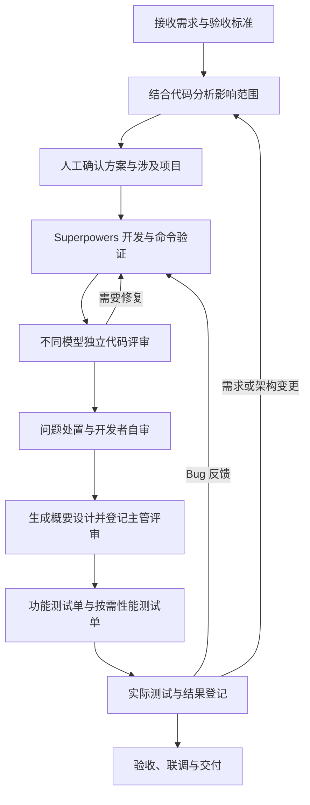

# Agent 开发工作台

面向后端开发者的本地 Agent 工作台，把需求分析、开发、代码评审、设计文档、测试及反馈组织为可追溯的流程。使用 OpenCode 或基于 OpenCode 封装的兼容 CLI，结合 Superpowers，在各需求独立的 Docker 工作区中执行任务，关键结论由人确认。

**本机运行方式：React 页面 + Python 控制 API + 独立 Runner + Docker，元数据默认存入本地 SQLite，无需额外部署数据库。**

[工作流程](#工作流程) · [启动说明](#启动说明) · [统一配置与 Windows 脚本](docs/28-local-configuration.md) · [Windows 11 兼容性](docs/27-windows11.md) · [首次接入项目](#首次接入项目) · [详细文档](#详细文档)

## 功能与页面

| 页面 | 用途 |
| --- | --- |
| 需求工作区 | 以六步向导显示当前待办，依次准备环境、分析、开发、评审、设计测试和验收；回看历史及查看差异和日志 |
| 项目登记 | 登记和修改单仓库或多 Git 仓库父目录，扫描并选择仓库与共享说明，维护镜像、CLI、资源、命令、环境变量、端口映射、只读/读写挂载及可选业务依赖 |
| Docker 镜像 | 查看、拉取和非强制移除镜像标签，维护 Dockerfile 版本与本机构建上下文目录，支持 COPY/ADD 文件后构建 |
| 容器管理 | 集中创建工作区、环境预检、启动/停止环境、管理应用服务及查看执行记录 |
| Agent CLI 配置 | 配置兼容封装 CLI 的服务、任务、版本命令，维护历史版本和新工作区默认值 |
| 跨项目交付 | 组织候选项目联合分析、确认整体范围、登记联调结果、导出交付包与归档 |
| 资源与恢复 | 查看 Runner、资源配额、SQLite 路径及离线维护说明 |

每个需求有独立代码副本和 Agent HOME，可以同时推进多个需求。同一需求的写操作串行，默认最多同时执行 2 个任务、运行 4 个受管容器；只读分析和评审副本也占用容器名额。

`.harness` 按 Git 中的原始内容直接复制，不解析配置或展开链接目标；Git 链接保存的目标文本会复制为普通文件，目标缺失或无效也可创建工作区，兼容 Windows。其他已提交的仓库内部相对链接仍可展开为独立文件/目录。多仓库父目录无需初始化 Git；排查及复制规则见[源码链接与导出](docs/31-source-links.md)。

封装 CLI 的镜像不必额外提供 `opencode` 命令。预检使用需求固定的 Agent CLI 服务和版本命令，并展示实际命令及启动诊断；参见[封装 CLI 预检](docs/32-wrapper-cli-preflight.md)。

CLI 要求登录、预检无法通过时，可在需求的“环境与手动工具”或“容器管理”使用“强制启动环境（排障）”：跳过预检，仅按固定配置启动容器，保留凭据挂载，不自动启动 CLI。页面提供进入容器的命令，检查完成后停止、重新预检，再正常启动；详见[登录与挂载排障](docs/32-wrapper-cli-preflight.md#cli-要求登录时强制启动环境排障)。

## 工作流程

首次使用先[准备项目环境](#首次接入项目)，之后按以下顺序推进需求：

新建需求后，详情页默认定位到实际待办，按 **准备环境 → 分析与方案 → 开发与验证 → 评审与自审 → 设计与测试 → 验收交付** 推进。先点击“创建工作区，开始准备”，之后页面会逐项提示预检、启动环境及开启流程。已完成步骤可点击回看，后续步骤完成前置操作后解锁；刷新页面会恢复到当前进度。

“执行记录”“代码差异与自审记录”“环境与手动工具”默认折叠，评审阶段会展开代码差异。任务失败时查看错误并在本步重试，状态不明时先“停止并核实”。详见[需求分步操作指南](docs/30-guided-requirements.md)。



1. **接收需求**：先登记单仓库项目或包含多个 Git 仓库的业务父目录。在「需求工作区」新建一个业务需求，填写背景、关联项目、候选仓库和验收标准。从列表选中需求后，可在详情标题旁点击「修改需求」，调整名称、背景和验收标准，保存新版本并保留旧内容及执行记录；关联项目和候选仓库保持固定。创建独立工作区，完成环境预检后启动环境。多仓库副本保留原相对布局，Agent 从共同父目录运行，可在一次会话中跨仓库开发。
2. **分析并确认范围**：在「分析与方案」点击「开启默认流程」，配置统一验证命令或选择固定配置中的逐仓库验证，再选择至少两个不同评审模型。只读分析可查看本需求全部候选仓库，由人确认具体改动范围。涉及多个独立登记的业务项目时，再在「跨项目交付」关联各业务需求、执行联合分析并确认整体范围；同一父目录内的多仓库需求无需重复录入。
3. **开发与验证**：明确启动 Superpowers 开发步骤，再运行本轮验证命令，检查实际退出码、日志和代码差异。
4. **独立评审与自审**：分别运行不同模型的代码评审。各模型使用独立只读副本；对阻断和主要问题逐项登记处置依据。需要修复时开启新修复轮次，修复后重新验证、评审，最后由开发者自审。
5. **概要设计与主管评审**：自审通过后，在「设计、测试与反馈」开始材料阶段，生成并检查服务端概要设计。主管在外部完成评审后，登记评审人、时间、意见和证据；工作台不代替主管批准。
6. **测试准备与执行**：明确是否需要性能测试，保存判断依据；生成功能测试单，需要时再生成性能测试单。实际执行测试后，登记逐项结果、环境与证据。生成测试单不代表测试已经执行。
7. **反馈与变更**：Bug 可开启修复轮次；需求变更和架构变更保存新需求修订，返回分析；文档意见生成或编辑新材料版本后重新评审。代码、需求或材料变化后，相关旧结论保留为历史，当前轮次需要重新确认。
8. **验收与交付**：满足当前代码、材料、测试和反馈门禁后登记材料验收。交付组还需登记实际联调结果，或说明无需联调的原因，再采集 ZIP 交付包、下载并归档。交付包包含代码、差异、设计、评审和测试记录；Git 提交、合并及部署由开发者另行完成。

流程按步骤由用户明确启动，人工确认点不会自动通过。Agent 完成、命令退出成功、代码自审通过和最终业务验收是不同的状态。

## 启动说明

### Windows：配置一次，再用脚本启停

安装 Python 3.11+（推荐 3.12）、Node.js 22.12+、Git 和 Docker Desktop；Docker Desktop 使用 WSL2 后端与 Linux 容器。在仓库根目录的 PowerShell 终端执行：

```powershell
Copy-Item workbench.example.toml workbench.toml
notepad workbench.toml
.\setup.cmd
.\start.cmd
```

`workbench.toml` 集中配置 SQLite 数据目录、端口、模型、资源配额、超时、代理/CA、工具镜像、日志目录和可选 Agent CLI 预置。`[environment]` 可提供模型/封装 CLI 的进程变量；现有环境变量优先于文件。相对路径以配置文件所在目录为基准。真实配置已被 Git 忽略，示例文件中不要填写密钥。

日志默认使用精简模式。在已有 `[workbench]` 下设置 `log_mode = "detailed"`，重启后即可查看内部步骤、耗时和等待状态；`log_mode = "concise"` 保留关键进度和结果。也可使用环境变量 `AWB_LOG_MODE` 覆盖。日志包含时间、组件、步骤和任务/需求 ID，页面执行日志显示当前阶段。配置、文件位置与排查方法见[日志模式与执行进度](docs/33-progress-logging.md)。

预检、分析和评审创建独立副本时，会保留已提交基线并只覆盖实际变化的文件；多仓库复用已核实的子仓库基线，Windows 批量处理可执行位。副本创建较慢时，可根据[源码副本性能与阶段计时](docs/34-source-copy-performance.md)定位具体阶段并运行样例对比。

`setup.cmd` 安装虚拟环境依赖、构建页面和基础镜像；未复制配置时会创建默认文件，已有文件不会覆盖。`start.cmd` 在后台启动同一配置的 API 和 Runner，通过认证的就绪检查后打开浏览器。日常操作：

```powershell
.\status.cmd
.\stop.cmd
.\start.cmd --no-browser
```

也可使用 `scripts/setup.ps1`、`start.ps1`、`stop.ps1`、`status.ps1`。停止会先让 Runner 完成取消/收尾，再关闭 API，按配置核实并停止当前数据目录的受管容器；不删除 SQLite、源码或材料。重复启停可安全重试，尚未结束的操作显示 `STOPPING`。安装升级前先停止服务。

详细字段、环境变量、CLI 预置、自定义配置路径、日志与故障恢复见[统一配置和本地脚本](docs/28-local-configuration.md)。下面保留 Linux/手动运行方式。

### 1. 环境要求

支持 Linux 主机，以及 **Windows 11 原生 Python + Docker Desktop Linux 容器**的运行方式。下方命令采用 Linux Bash；Windows 用户请使用 [PowerShell 启动指南](docs/27-windows11.md)，其中列出了兼容性检查和实测边界。

| 依赖 | 要求 |
| --- | --- |
| Python | 3.11+，可创建 venv |
| Node.js / npm | Node.js 22.12+，用于构建 Web 页面 |
| Git | 已安装；每个候选仓库都有提交记录，多仓库共同父目录无需初始化 Git |
| Docker | 已启动守护进程，运行 Runner 的用户有访问权限，可执行 `docker info` |
| 网络 | 构建镜像时能访问软件源；运行 AI 任务时能访问所选模型服务和模型目录 |

工作台使用 SQLite 保存配置、需求、队列、日志与材料，首次启动自动建库并升级表结构。**无需安装 PostgreSQL、MySQL 或 Redis。** 项目运行配置中的 PostgreSQL 是待开发业务的可选依赖，默认关闭，与工作台数据库分开。

Windows 11 需要 Docker Desktop 启用 WSL2 后端并使用 Linux 容器；API 和 Runner 可以直接在 PowerShell 运行。Windows 的虚拟环境 Python 位于 `.venv\Scripts\python.exe`，环境变量用 `$env:AWB_MODEL = "..."` 设置。不要直接复制下面的 Bash 命令到 PowerShell。

### 2. 获取源码、安装并构建

```bash
git clone https://github.com/hicjcn/workbench.git
cd workbench

python3 -m venv .venv
.venv/bin/python -m pip install -e '.[server]'
npm ci --prefix web
npm run --prefix web build

docker build -t agent-workbench-m1:local poc/container
```

该镜像包含锁定的 OpenCode `1.19.4`、Superpowers、Node 和 Git。项目需要 Java、Maven、Go 等工具时，应基于它构建项目镜像，见[项目接入说明](docs/14-m6-project-onboarding.md)。只打开管理界面可以先启动 API；实际执行需要 Runner、Docker 和可用的运行镜像。

代理或自定义 CA 环境需按 [M1 运行说明](docs/04-m1-runbook.md)配置 Docker 代理与 BuildKit `proxy_ca` secret，保持 TLS 校验开启。

### 3. 终端一：启动控制 API 与页面

以下命令使用 OpenCode 免费模型标识作为示例。**模型当前是否开放、额度是否可用，需要在实际运行环境核实**，见[模型配置](#模型配置)。

```bash
# 在 workbench 仓库根目录运行
AWB_MODEL=opencode/glm-5.3-flash-free \
  .venv/bin/python -m agent_workbench.server \
  --sqlite --data-dir "$PWD/.local-data/workbench"
```

API 默认监听 `127.0.0.1:8340`，同时提供 `web/dist` 构建后的页面。`--sqlite` 明确使用指定数据目录中的 `workbench.db`，忽略已有 `AWB_DATABASE_URL`。首次启动会输出数据库位置和本机访问令牌的**文件路径**。

### 4. 终端二：启动 Runner

另开终端，进入**同一个 workbench 仓库根目录**后执行：

```bash
AWB_MODEL=opencode/glm-5.3-flash-free \
  .venv/bin/python -m agent_workbench.runner \
  --data-dir "$PWD/.local-data/workbench" \
  --api http://127.0.0.1:8340
```

API 与 Runner 必须使用**相同的绝对数据目录和 `AWB_MODEL`**。Runner 通过认证接口领取任务，负责 Docker 操作；API 不访问 Docker。只启动 API 时页面可以打开，但排队任务不会执行。

### 5. 登录并检查运行状态

打开 **[http://127.0.0.1:8340](http://127.0.0.1:8340)**，在本机读取启动提示的 `access-token` 文件，将内容填入登录表单。默认文件为 `.local-data/workbench/access-token`，它是工作台访问令牌，和模型密钥不同。

进入「资源与恢复」，确认 Runner 已上报、Docker 资源可用、存储类型为 SQLite；再到「Docker 镜像」确认基础镜像存在。至此可以登记项目和创建需求。

### 日常启动、更新与前端开发

日常使用只需启动上述 API 和 Runner 两个进程，已有数据会保留。更新代码或依赖后，停止两个进程，在仓库根目录执行：

```bash
git pull --ff-only
.venv/bin/python -m pip install -e '.[server]'
npm ci --prefix web
npm run --prefix web build
```

再用相同参数启动 API 和 Runner，API 会自动应用数据库迁移；工具镜像变更时另行重建镜像。重要数据应先[离线备份](#停止备份与恢复)。

修改前端时可另开终端执行 `npm run --prefix web dev`，访问终端提示的 Vite 地址。开发服务器将 `/api` 转发到 `127.0.0.1:8340`，仍需运行 API，执行任务还需 Runner。普通使用无需启动 Vite。

## 首次接入项目

建议先用仓库自带的 Node 样例验证镜像、目录和命令配置，再接入业务项目。

### 创建样例仓库

在 workbench 根目录执行，目标样例目录必须尚不存在：

```bash
docker build -t agent-workbench-node:local poc/onboarding

(
  set -e
  sample_project_dir="$HOME/workbench-samples/node-service"
  test ! -e "$sample_project_dir"
  mkdir -p "$HOME/workbench-samples"
  cp -R poc/sample-project "$sample_project_dir"
  git -C "$sample_project_dir" init -b main
  git -C "$sample_project_dir" add --all
  git -C "$sample_project_dir" -c user.name='Workbench Sample' \
    -c user.email='sample@example.invalid' commit -m 'Initial sample'
)
```

### 在界面接入

1. 「项目登记」→「登记项目」：填写样例仓库的实际绝对路径和镜像 `agent-workbench-node:local`。源码仓库应位于工作台数据目录之外，工作区数据目录也不能位于该源码仓库内部。
2. 在该项目的「项目运行配置」保存以下内容，填写登记人和原因。可解析配置示例见 [profile.sample.json](poc/onboarding/profile.sample.json)。

   | 配置项 | 样例值 |
   | --- | --- |
   | 镜像 | `agent-workbench-node:local` |
   | Agent CLI | 内置 OpenCode，或已安装在此镜像中的兼容封装 |
   | 构建命令 | `node --check server.mjs` |
   | 验证命令 | `node --test server.test.mjs` |
   | CPU / 内存 / PID | `1` / `1536 MiB` / `256` |
   | 业务数据库 / 应用服务 | 首次验证可以均不启用 |

3. 「需求工作区」→「新建需求」→「创建工作区」。在「容器管理」或需求的环境面板运行「环境预检」，通过后「启动环境」。
4. 执行项目构建和项目验证，检查任务记录。以上检查不调用模型；通过表示基础接入可用，随后按[工作流程](#工作流程)开启 AI 开发。

接入真实项目时，替换源码路径、运行镜像和命令。项目登记后可通过卡片上的「修改登记」调整名称、目录、仓库、共享文件和默认镜像；已有工作区保留独立源码副本。活动或待核实任务期间不能更改源码登记，也不能移除未准备需求已选择的仓库。

「项目运行配置」采用宽屏分栏弹窗，还可配置：

- `run_as_root`：勾选“以 root 执行容器命令，并先加载 /root/.bashrc”后，以 root 执行业务命令，适用于 CLI 或 Node/NVM 安装在镜像 `/root` 下的情况。配置界面新建或未设置时默认勾选；未修订的旧配置缺少此字段时仍按普通用户运行。取消勾选则使用原容器用户并加载其可读的 `HOME/.bashrc`。
- `environment`：如 `{"APP_ENV": "development"}`，传入开发和应用容器，变量值随配置保存。模型/CLI 凭据继续使用本机私有配置或已有进程环境。
- `port_mappings`：如 `[{"container_port": 3000, "host_port": null, "protocol": "tcp", "service": "agent"}]`。宿主端口留空时自动分配，也可指定；均限制在 `workbench.port_range_start` 至 `port_range_end`（默认 `20000–29999`）内，只绑定本机 `127.0.0.1`。`service` 可选开发容器 `agent` 或已启用的应用服务 `application`。
- `volume_mounts`：如 `[{"source": "D:\\data\\uploads", "target": "/mnt/uploads", "read_only": false}]`，直接挂载现存文件或目录。默认只读，读写挂载会将修改写回宿主机。原有 `mounts` 仍将普通配置文件复制并固定摘要，以只读方式挂载到 `/run/workbench-config/`。

端口范围也可通过 `AWB_PORT_RANGE_START` / `AWB_PORT_RANGE_END` 设置，详见[统一配置](docs/28-local-configuration.md#项目运行环境)。构建/验证命令按参数列表执行，复杂操作放入仓库脚本，不在表单拼接 Shell 管道或重定向。

项目配置和 CLI 配置在**创建工作区任务入队时**固定，Runner 准备时固定实际镜像 ID。修改项目配置、默认 CLI 或镜像标签不会自动改变已有需求。已有工作区可先停止环境、处理活动或待核实任务，再在需求详情的「项目环境与预检」或「容器管理」点击「同步最新配置」。原先未绑定运行配置的旧工作区也可通过该入口采用项目配置。

同步任务在入队时固定目标项目配置：使用其中指定的 CLI 版本，未指定时采用当前系统默认 CLI，并重新解析本机镜像标签；同版本也可重新同步以刷新镜像。源码、Agent 会话和数据库数据保留，旧预检结果清除，旧流程、自审与材料结论失效，历史记录保留。同步不会自动预检或启动，完成后需重新执行「环境预检」，通过后再「启动环境」。

## Agent CLI 与模型配置

### 更换 OpenCode 兼容 CLI

对于“仅程序名不同，其余与 OpenCode 一致”的封装：

1. 先把实际 CLI 安装到项目镜像中，并保留 OpenCode 服务协议及 Superpowers 工具环境。
2. 打开「Agent CLI 配置」→「添加封装 CLI」，填写程序名或容器内路径。页面自动生成服务、任务和版本命令；例如程序名为 `team-code`：

   ```text
   team-code serve --hostname {host} --port {port}
   team-code run --attach {endpoint} --model {model} --format json
   team-code --version
   ```

3. 保存任务超时、可选的精确版本输出及所需凭据**变量名**，设为新工作区默认，或在「项目运行配置」选定具体版本。
4. 创建新工作区，或停止已有环境后同步最新配置，再执行预检并验证实际任务。管理页面只保存配置，不会自动安装 CLI。

启动环境时保留镜像自己的 `ENTRYPOINT` 和 `CMD`；Dockerfile 可以只启动 code-server。容器启动后，工作台通过 `docker exec` 启动需求固定的 CLI 服务，并独立记录服务状态、退出码与日志，再等待 OpenCode 兼容接口就绪。镜像默认服务需要持续运行，不要另行启动占用 `4096/tcp` 的 Agent 服务。旧版内置工具镜像默认启动 OpenCode，升级后需重建 `poc/container` 及其派生镜像，再停止、同步已有需求并重新预检；新的内置镜像默认只保持容器运行。

运行镜像需要包含 `/bin/bash`。root 模式在每次业务命令前加载 `/root/.bashrc`，初始化期间使用 `HOME=/root`，执行命令时恢复该需求的独立 `HOME=/home/node`；镜像中的 `/root` 和 NVM 程序不会被 Agent HOME 挂载遮住。CLI 服务与任务、构建/验证、Node 预检和应用检查均使用同一初始化机制，初始化输出不混入业务输出；受控 PostgreSQL 命令保持独立。root 模式下 `/root/.bashrc` 缺失或不可读会明确报错。更改运行用户后需保存新配置版本，并停止、同步已有需求后生效。

当前支持 OpenCode 兼容 HTTP API、认证、标准输入和 JSONL 事件格式。其他协议的 CLI 需要单独适配，详见 [Agent CLI 接入](docs/26-agent-cli.md)。如报 `executable file not found in $PATH`，请查看预检启动诊断中的容器 PATH，并核对程序的容器内路径；处理步骤见[封装 CLI 镜像预检](docs/32-wrapper-cli-preflight.md#镜像找不到-cli-时如何处理)。

### 模型配置

`AWB_MODEL` 选择分析、开发和材料生成模型；代码评审模型在开启开发流程时另行选择，至少两个不同模型。**切换 CLI 不会切换模型服务或解除现有模型限制。**

| 选项 | 配置与要求 |
| --- | --- |
| OpenCode 免费模型 | 支持显式 `opencode/*-free` 或 `opencode/big-pickle` 标识；免凭据路径仍受服务开放情况、额度和网络影响 |
| OpenRouter 免费模型 | 支持 `openrouter/vendor/model:free`；Runner 需要继承已有的 `OPENROUTER_API_KEY`，执行前核实公开目录免费价格 |
| 未显式设置模型 | 优先读取 `workbench.toml`；示例文件选择 OpenCode 免费模型。没有配置文件或环境覆盖时沿用代码默认 OpenRouter 免费 Nemotron，需要已有凭据 |

API 和 Runner 启动时均需设置同一个 `AWB_MODEL`。更换模型后重启两个进程，并停止、重新启动需求环境以应用配置。当前没有任意付费模型接入或付费回退，不能只填入其他厂商模型名就认为已经支持。

凭据可写入本机私有 `workbench.toml` 的 `[environment]` 表，或由 Runner 继承已有环境变量；已有环境变量优先。封装 CLI 管理页面只登记变量名。工作台不自动加载其他 `.env` 文件；实际密钥不放进 CLI 参数、Dockerfile 或 Git。

需要检查网络时，可使用不发送提示词的诊断命令：

```bash
.venv/bin/python -m agent_workbench.acceptance doctor \
  --review-model opencode/glm-5.3-flash-free \
  --review-model opencode/big-pickle
```

诊断需在与 Runner 相同的网络及认证环境中运行；网络可达也不代表模型推理已通过。

## 停止、备份与恢复

先在页面等待或取消并核实活动任务，停止需求环境，再分别用 `Ctrl+C` 停止 API 和 Runner。**仅结束两个 Python 进程不会自动停止已有 Docker 容器。** 离线维护时，在 workbench 根目录执行：

```bash
# API 和 Runner 均已退出；核实并停止本数据目录的受管资源
.venv/bin/python -m agent_workbench.maintenance stop \
  --sqlite --data-dir "$PWD/.local-data/workbench"

# 生成备份，命令输出 ZIP 路径
.venv/bin/python -m agent_workbench.maintenance backup \
  --sqlite --data-dir "$PWD/.local-data/workbench"
```

备份保存配置、工作区代码与 Git 历史、流程材料及执行记录。镜像层、访问令牌、模型凭据和只读配置文件内容不包含在内；恢复后需另行准备。镜像维护任务处于运行或 UNKNOWN 时，先在主机核实并通过镜像管理页处理，再进行备份。

恢复到**尚不存在的新目录**，不覆盖原数据：

```bash
.venv/bin/python -m agent_workbench.maintenance restore \
  --archive /absolute/path/to/backup.zip \
  --destination "$PWD/.local-data/workbench-restored"
```

恢复后用新目录作为两个进程的 `--data-dir`，API 继续加 `--sqlite`，使用新目录的 `access-token` 登录。恢复不会自动重放任务或启动容器。详细边界见[交付与恢复](docs/12-m5-delivery.md)和[本地 SQLite](docs/25-local-sqlite.md)。

默认数据目录包括：

```text
.local-data/workbench/
├── workbench.db          # SQLite 元数据；运行中可能有 -wal / -shm 文件
├── access-token          # 本机页面登录令牌
├── runner-token          # Runner 独立认证令牌
├── workspaces/           # 各需求代码副本、Agent HOME 和运行状态
├── locks/                # 单机操作锁
├── exports/              # 材料导出
├── deliveries/           # 交付包
└── backups/              # 离线备份
```

请持久保存整个数据目录。不要在服务写入时只复制 `workbench.db`，SQLite WAL 中可能仍有未合并事务。

## 常见问题

| 现象 | 检查与处理 |
| --- | --- |
| 页面打不开或没有前端页面 | 确认 API 已启动、端口为 `8340`，并已执行 `npm run --prefix web build`；API 仅监听本机回环地址 |
| 任务一直排队 | 确认 Runner 已启动、数据目录及 API 地址一致、模型配置一致，检查「资源与恢复」的上报与配额 |
| Docker 不可用、镜像不存在 | 在 Runner 所在主机确认 `docker info` 可执行，并构建基础/项目镜像；宿主机安装 CLI 不代表镜像内已安装 |
| 创建工作区失败 | 确认填写的是有提交记录的 Git 根目录，源码与工作台数据目录互不包含；子模块、未物化的 Git LFS 文件等限制见 M1 说明 |
| Windows 启动报 `No module named fcntl` | 更新到包含 Windows 兼容修复的版本，重新安装 `.[server]`；不要尝试安装同名 `fcntl` 包。详见 Windows 指南 |
| Windows 无法连接 Docker pipe | 启动 Docker Desktop，确认 WSL2 后端、Linux 容器及本机 `dockerDesktopLinuxEngine` 管道可用 |
| 预检通过但模型调用失败 | 预检不发起推理；另查模型当前开放情况、Runner 凭据、代理、CA 和模型服务网络，运行 `acceptance doctor` 辅助诊断 |
| 更新配置后旧需求仍用旧版本 | 停止环境并处理活动或待核实任务，在「项目环境与预检」或「容器管理」同步最新配置，再预检并启动 |
| 任务为 UNKNOWN / 待核实 | 先检查现场，再使用「停止并核实」；跨项目操作核实全部成员。镜像维护使用单独的人工核实入口，不自动重试 |
| 站点里点击启动没有真实容器 | Sites 站点是浏览器试用版，使用 localStorage，不运行 Python API、SQLite、Docker 或 Runner；真实开发按本文部署本机版 |

## 开发验证与当前边界

在已安装依赖的源码目录中运行：

```bash
.venv/bin/python -m unittest discover -s tests -v
node --test poc/sample-project/server.test.mjs
npm run --prefix web build
```

需要实际容器、浏览器或在线样例验收时，按对应专项文档准备 Docker、可选浏览器依赖和全新验收目录。当前已完成本地控制、流程、材料、项目环境、Docker 管理及兼容 CLI 的检查；完整在线多模型样例和真实业务项目仍需验收。受控报告、预检及模拟任务不作为真实模型推理或业务测试通过的证明。

## 详细文档

先读[需求文档](docs/01-requirements.md)、[整体设计](docs/02-overall-design.md)与[实施计划](docs/03-implementation-plan.md)。专项说明按主题查阅；早期里程碑文档描述当时范围，当前启动入口以本 README 为准。

| 主题 | 操作说明 | 验证记录 |
| --- | --- | --- |
| 容器与 Agent 原型 | [M1 运行](docs/04-m1-runbook.md) | [M1 验证](docs/05-m1-validation.md) |
| 控制 API 与 Runner | [M2 工作台](docs/06-m2-workbench.md) | [M2 验证](docs/07-m2-validation.md) |
| 开发流程与独立评审 | [M3 流程](docs/08-m3-workflow.md) | [M3 验证](docs/09-m3-validation.md) |
| 概要设计、测试与反馈 | [M4 材料](docs/10-m4-materials.md) | [M4 验证](docs/11-m4-validation.md) |
| 跨项目交付与恢复 | [M5 交付](docs/12-m5-delivery.md) | [M5 验证](docs/13-m5-validation.md) |
| 项目镜像、命令与挂载 | [M6 项目接入](docs/14-m6-project-onboarding.md) | [M6 验证](docs/15-m6-validation.md) |
| 可选业务 PostgreSQL | [M7 业务依赖](docs/16-m7-dependencies.md) | [M7 验证](docs/17-m7-validation.md) |
| 应用启动与 HTTP 检查 | [M8 应用服务](docs/18-m8-application.md) | [M8 验证](docs/19-m8-validation.md) |
| 多项目只读联合分析 | [M9 全景分析](docs/20-m9-panorama.md) | [M9 验证](docs/21-m9-validation.md) |
| 完整在线样例验收 | [M10 验收工具](docs/22-m10-acceptance.md) | [M10 验证与阻断](docs/23-m10-validation.md) |
| Docker 管理 | [镜像维护与容器管理](docs/24-docker-management.md) | 说明内附证据 |
| SQLite | [本地存储与维护](docs/25-local-sqlite.md) | 说明内附验证范围 |
| Agent CLI | [兼容封装配置](docs/26-agent-cli.md) | 说明内附证据 |
| Windows 11 | [兼容性与 PowerShell 启动](docs/27-windows11.md) | Windows/Linux CI 及实测边界 |
| 统一配置与本地脚本 | [TOML、环境覆盖及 Windows 启停](docs/28-local-configuration.md) | 说明内附验证范围 |
| 多 Git 仓库工作区 | [父目录登记、统一需求与逐仓库验证](docs/29-multi-repository-workspaces.md) | 说明内附验证范围 |

可运行的接入示例：[Node 配置](poc/onboarding/profile.sample.json)、[项目 Dockerfile](poc/onboarding/Dockerfile)、[PostgreSQL 配置](poc/postgres-sample/profile.sample.json)。`design-examples/*.yaml` 是设计评审示意，当前不是可直接执行的 Compose、OpenCode 或流程配置。
