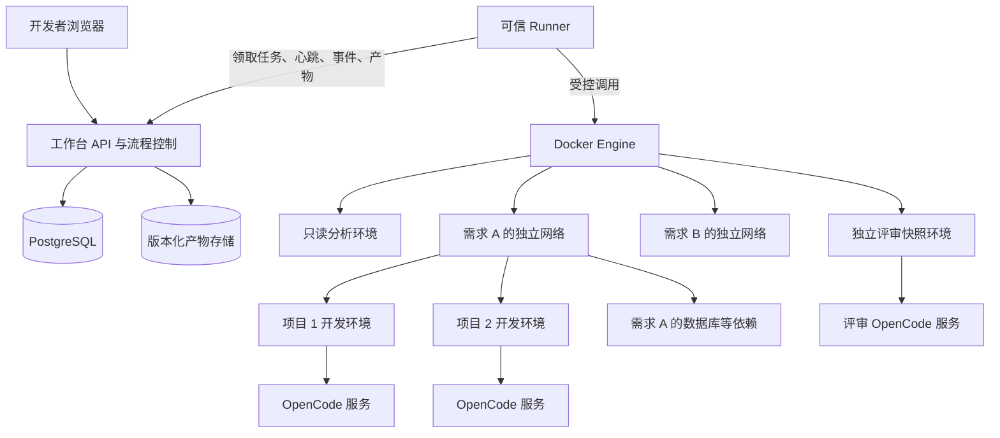
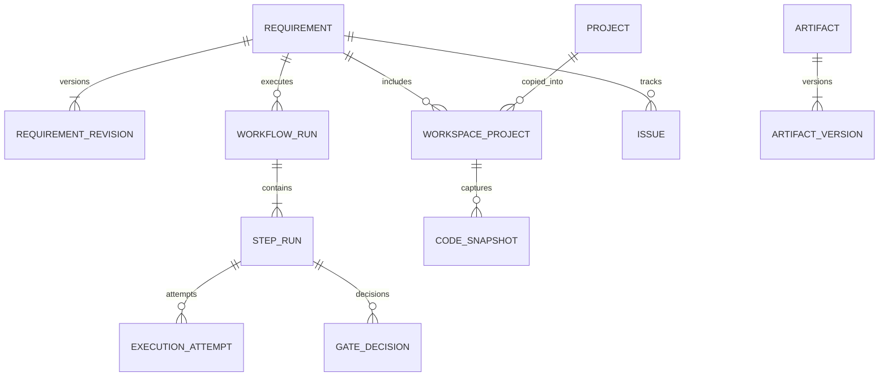
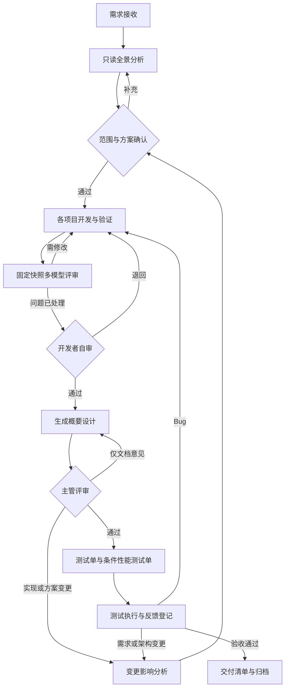

# Agent 开发工作台整体设计

- 版本：V0.1
- 日期：2026-10-24
- 对应需求：[需求文档](01-requirements.md)
- 状态：整体方案；M1—M7 已合并，M8 应用服务首轮实现见 [运行说明](18-m8-application.md)；完整方案不等同于当前已验收能力

## 1. 设计结论与默认选择

采用「单机部署、模块化控制后端、独立 Runner、按需求隔离的 Docker 环境」架构。OpenCode 执行具体 Agent 工作，工作台负责需求、流程、调度、确认、版本及交付。

| 决策 | 当前方案 | 原因与边界 |
| --- | --- | --- |
| 使用方式 | 单人 Web 工作台 | 方便并行查看需求、运行及产物；主管和测试反馈先手工登记 |
| 后端形态 | 模块化单体 API，加独立 Runner 进程 | 业务逻辑集中，Docker 权限限制在 Runner |
| 调度 | SQL 数据库持久化任务与租约 | M2 默认 SQLite，兼容 PostgreSQL，避免额外消息队列 |
| Agent 接入 | OpenCode HTTP 为主，CLI 为兼容路径 | 使用结构化会话与事件，保留版本兼容能力 |
| 隔离单位 | 需求网络；项目独立代码/开发容器；评审独立快照 | 同时支持多需求及跨项目协作 |
| 源码 | 复制为独立 Git 仓库和工作目录 | 原始代码不被 Agent 直接改动，不依赖宿主机 worktree |
| 流程 | 版本化模板、显式状态、人工确认点 | 过程可恢复，确认结果有适用版本 |
| 产物 | 版本化文件及数据库索引 | 文档、代码快照和结论可相互追溯 |

这些是本方案的建议默认值，不代表用户已经确定语言和部署位置。

### 1.1 参考技术栈

| 层次 | 建议默认值 | 可替换条件 |
| --- | --- | --- |
| 前端 | React + TypeScript + Vite | M2 已建立工程，由本机 API 提供构建产物 |
| API | Python + FastAPI | 若开发者更熟悉 Java/Spring Boot，可替换 API/业务层实现 |
| Runner | Python 独立进程，Docker Engine 客户端 | 接口与业务层分离，可独立替换 |
| 数据库 | M2 默认 SQLite，支持 PostgreSQL，使用 Alembic 迁移 | 保存需求、任务、事件、租约和确认记录 |
| 文件存储 | 单机持久目录，按内容摘要索引 | 后续可替换为对象存储 |
| 部署 | 宿主机 Runner；API、数据库等由 Compose 管理 | 同样适用于单台开发服务器 |
| 实时状态 | 浏览器通过 API 的 SSE 接收事件 | 不让浏览器直接访问 Agent 服务 |

语言选择不会改变需求、状态机、数据边界和执行协议。技术验证结束后再锁定依赖版本和具体库。

## 2. 系统边界

工作台负责：

- 管理需求、项目清单及相关知识。
- 创建隔离工作区，记录环境与代码版本。
- 组织流程、调度 Agent、收集结果、执行版本校验。
- 提供评审、文档、测试反馈及导出入口。

OpenCode 负责调用模型和工具完成分析、编码及生成任务。Superpowers 作为 OpenCode 内的技能和开发方法使用。系统不重新实现模型推理或另建一套内部 Agent 框架。

实际开发的业务项目是被管理对象，与工作台本身的代码、数据库和配置分开。

## 3. 总体架构



图中网络节点表达逻辑归属。API 和控制数据库不加入需求网络；Runner 通过仅绑定宿主机回环地址的受控端口访问 OpenCode。Agent 容器不持有工作台 API 管理凭据。

### 3.1 信任与部署边界

1. 浏览器只能调用工作台 API，不能指定任意 Docker 参数或直接访问 OpenCode。
2. API 负责鉴权、配置校验和业务状态，不挂载 Docker Socket。
3. Runner 是可信宿主机程序，有管理指定 Docker 实例的权限，按类型化任务执行操作。
4. Runner 以出站连接向 API 领取任务，不开放可被 Agent 调用的宿主机命令接口。
5. Agent 容器只看到需求允许的代码、配置和服务。
6. 模型服务是代码及需求可能离开本机的外部边界，按项目配置允许的服务和模型。

单人本地模式默认监听回环地址，使用安装级访问凭据或本地会话，写接口校验来源。远程部署增加 TLS 和单用户登录；团队 RBAC 留待多人协作阶段。

## 4. 后端模块职责

| 模块 | 主要职责 | 不应承担的工作 |
| --- | --- | --- |
| 需求与项目 | 需求版本、项目登记、候选范围、验收标准 | 执行 Docker 命令 |
| 工作区 | 源码副本、项目工作区、代码基线、环境配置版本 | 直接推理业务方案 |
| 流程引擎 | 步骤依赖、状态、人工确认、重试及结果适用性 | 将模型回复直接视为完成 |
| 任务调度 | 排队、资源分配、租约、互斥与中断核实 | 自动重放未知状态的代码修改 |
| 执行适配 | 统一调用 OpenCode HTTP/CLI | 持有业务审批权 |
| 评审与反馈 | 模型问题、自审、Bug、变更及处理依据 | 自动采纳所有模型意见 |
| 产物与上下文 | 文档版本、输入包、证据、摘要和导出 | 静默覆盖人工修改 |
| 配置与审计 | 模板版本、凭据引用、权限策略及操作记录 | 将明文密钥写入普通配置 |

模块先在一个业务工程内实现，通过明确接口交互。Runner 是独立部署单元，不要求第一版拆成多个业务服务。

## 5. 核心领域与数据模型

### 5.1 主要关系



### 5.2 核心表

| 表 | 关键字段 | 说明 |
| --- | --- | --- |
| `project` | id, name, source_ref, default_branch, profile_id | 项目登记，source_ref 不含密码 |
| `project_profile_revision` | profile_id, version, spec, digest | 环境、命令、挂载和依赖配置的不可变版本 |
| `model_profile_revision` / `prompt_template_revision` | profile_id, version, provider_model, credential_ref / template_id, version, content_digest | 模型角色及提示词版本，不保存明文凭据 |
| `requirement` | id, title, current_revision_id, phase, lifecycle | 当前指针和需求生命周期 |
| `requirement_revision` | id, requirement_id, version, content, reason | 原始需求、验收标准及变更 |
| `workspace_project` | id, requirement_id, project_id, generation, source_snapshot_id, environment_id | 某需求某项目的代码副本 |
| `environment` | id, kind, generation, desired_state, observed_state, image_digest, resource_refs | 区分期望状态与实际状态 |
| `code_snapshot` | id, workspace_project_id, commit_sha, patch_digest, tree_digest, manifest_ref | 包括已提交、未提交和纳入范围的未跟踪文件 |
| `baseline_set` | id, requirement_revision_id, digest | 一组项目快照构成跨项目基线 |
| `baseline_member` | baseline_set_id, workspace_project_id, snapshot_id | 联调、评审和交付引用同一版本向量 |
| `project_relation` | requirement_revision_id, from_project_id, to_project_id, relation_type, evidence_ref, confirmation_ref | 需求范围内的调用、接口或开发依赖 |
| `workflow_template_revision` | template_id, version, spec, digest | 流程定义、分支和步骤策略 |
| `workflow_run` | id, requirement_id, template_revision_id, input_baseline_id, status | 某一轮需求处理 |
| `step_run` | id, workflow_run_id, step_key, scope_id, status, input_digest, validity | 阶段实例，scope_id 为需求或项目 |
| `step_dependency` | upstream_id, downstream_id, condition | 必须成功或已确认可跳过等条件 |
| `execution_attempt` | id, step_run_id, attempt_no, dispatch_state, runner_id, lease_epoch, runtime_ref, external_session_id | 重试新增记录，不覆盖历史 |
| `execution_event` | attempt_id, seq, event_type, payload_ref, occurred_at | 已脱敏的结构化事件和日志索引 |
| `artifact` / `artifact_version` | type, scope_id / version, blob_ref, content_digest, provenance, validity | 逻辑产物与不可变版本分开 |
| `artifact_dependency` | artifact_version_id, upstream_ref, upstream_digest | 结果过期判定的依据 |
| `gate_decision` | step_run_id, decision, baseline_id, artifact_version_ids, actor, reason | 确认绑定当时输入 |
| `issue` / `issue_event` | type, severity, status, source_ref / action, reason | 问题及处理历史 |
| `test_case` / `test_execution` | requirement_ref, expected / baseline_id, result, evidence_ref | 用例定义和实际执行分开 |
| `credential_reference` | alias, provider_type, locator, allowed_scope | 只存引用及元数据 |
| `workspace_lease` / `resource_allocation` | scope_id, owner, epoch, expires_at / cpu, memory, ports | 写互斥与资源占用 |

`artifact_version.provenance` 至少包含需求版本、项目集合、代码基线、流程/提示词/环境配置版本、执行尝试、工具版本、模型、生成时间和人工修改来源。

### 5.3 数据约束

- 所有可变业务记录使用版本号进行并发更新检查。
- 模板、需求历史、代码快照及产物版本创建后不可原地修改。
- 同一有效项目工作区同一时刻仅允许一个写入者；人工编辑也应进入写入会话。
- 同一个 `step_run` 只允许一个活动执行尝试；重试次数唯一。
- 任务领取以数据库事务为准；具体实现可使用行锁和 `SKIP LOCKED`。
- 回调携带 attempt_id、lease_epoch 和事件序号，拒绝过期租约写回最终结论。
- 一轮流程固定模板版本；模板更新只影响新流程，迁移已有流程需要显式记录。
- 软删除保留引用；清理文件前校验是否仍被有效产物、快照或交付清单引用。

## 6. 工作区与源码设计

### 6.1 持久目录

以下是部署后的示例布局，非当前已创建的运行目录：

```text
agent-workbench-data/
  source-cache/                  # 可信层维护，Agent 不可写
  workspaces/<requirement-id>/
    projects/<project-id>/
      repo/                      # 独立仓库与完整 .git
      agent-state/dev/            # 该项目开发会话持久数据
      staging/<attempt-id>/       # 待收集输出
  snapshots/<snapshot-id>/        # 不可变代码快照
  artifacts/sha256/<digest>/      # 正式产物，Agent 不可直接覆盖
  runs/<attempt-id>/              # 脱敏日志、输入包和执行清单
  runtime-secrets/                # 临时敏感文件，限制权限及生命周期
```

需求代码位于需求专属持久目录，再挂载到容器 `/workspace/project`。这属于独立副本，不是将用户原始仓库可写挂入容器。依赖服务默认使用独立命名卷，资源使用 requirement_id、project_id、generation 标签管理。

### 6.2 源码初始化

1. 固定源仓库提交；本地目录先记录 HEAD 和工作区状态。
2. 建立完整独立仓库，不引用宿主机 worktree 的共享 Git 目录，不使用会向源目录写入的链接。
3. 按选择附加未提交差异及未跟踪源码，生成清单和摘要。
4. 默认排除凭据、`.env`、依赖安装目录和无关构建产物；项目可显式配置例外。
5. 处理子模块、LFS、符号链接和文件权限，缺少能力时明确失败或标记不支持。
6. 建立需求分支和初始快照，记录 source_commit、tree_digest 及配置版本。
7. 不自动推送；导出差异由开发者检查后进入既有交付渠道。

从本地非干净目录读取时，需要核实复制前后的状态。源目录发生并发修改则重新采集或提示重新选择基线，不能生成混合版本。

### 6.3 项目全景分析的代码可见性

范围确认前，先通过项目目录及已有文档确定候选项目，再为授权候选项目创建只读分析快照。分析环境可只读查看多个候选项目，无权写入开发副本或其他需求数据。

分析报告记录覆盖清单及每条关键结论的代码证据。确认涉及项目后才创建或启用对应开发环境。若后续发现新项目，则补充分析并重新确认范围。

### 6.4 并发写与人工接管

默认一个项目开发容器对应一个活动写会话。用户从工作台发起人工接管前，先让当前 Agent 到达安全停止点或完成取消核实，再释放写锁。

外部编辑器绕过工作台写入时无法仅靠数据库锁阻止，因此在运行前后和确认时重新计算快照。检测到意外变化时将结果标记为需要核实，并暂停自动推进。

## 7. Docker 与资源隔离

### 7.1 环境类型

| 类型 | 源码权限 | 状态与用途 |
| --- | --- | --- |
| 分析环境 | 候选项目快照只读 | 分析后可销毁，只保存报告和依据 |
| 开发环境 | 当前项目副本可写 | 会话及代码持久化，允许授权开发命令 |
| 评审环境 | 固定审查快照只读 | 各模型独立会话，输出到单独 staging |
| 验证环境 | 固定快照的临时可写副本 | 运行构建/测试，构建产物不改动开发基线 |
| 依赖环境 | 需求独立数据 | 数据库、缓存、队列等；禁止默认连接生产写服务 |

评审需要执行构建时，使用该快照的临时可写副本和隔离测试数据。不能把提示词中的“只读”当作文件系统隔离。

### 7.2 环境生命周期

`DECLARED → PREPARING → STARTING → READY → STOPPING → STOPPED`

失败进入 `ERROR`；重建增加 generation，替换运行资源并保留代码及所选数据。销毁运行资源后仍可保留工作区；删除工作区数据是独立操作，展示会删除的具体内容。

期望状态与观察状态分开保存。Runner 定期通过 Docker 标签核实资源，处理控制服务重启、构建中断及遗留容器。未完成文件和卷清理前不宣称数据已彻底删除。

### 7.3 隔离与权限

- 每个需求独立网络，跨项目联调仅连接需求内必要服务。
- 开发容器不使用特权模式、host 网络或宿主机 Docker Socket。
- 默认以非 root 账户运行；镜像构建需要的 root 与运行时权限分开。
- 只挂载需求代码、受控配置和允许的数据；不默认同步用户整个主目录。
- CPU、内存、PID 和日志大小设置限制；磁盘先做用量监控、阈值停止，只有运行环境支持时才宣称具备硬配额。
- OpenCode 端口动态分配且仅绑定宿主机回环地址，启用独立访问凭据。
- 共享缓存默认只读；必须可写时按项目/工具版本划分，并避免跨需求写冲突。
- Compose 配置由可信配置生成，拒绝不在允许范围的挂载、网络和 Docker 选项。

不同 Docker bridge 主要解决连通范围和命名冲突，不能自行实现域名白名单，也不自动阻止访问所有宿主机地址。严格出站限制需要可信代理和宿主机防火墙配合；需同时限制直连、代理旁路及控制服务地址。界面区分“已配置”“已执行”和“不支持”，不把声明当作执行证据。

Docker 共享内核，默认方案适用于用户自己的开发代码与受控工具。若将来需要执行来源不可信的任意代码，可将 Runner 所管理的 Docker 放入独立虚拟机，同时保留同一执行协议。

### 7.4 环境接近本机

将语言版本、构建工具、包源、代理、时区、字符集、证书和必要配置编码进项目模板。敏感配置运行时注入；需要认证的构建使用临时构建凭据，不写入 Dockerfile 层。

记录宿主机与镜像 CPU 架构、系统差异及不可移植服务。通过初始化诊断报告展示 Git、语言运行时、OpenCode、插件、依赖连接和项目构建检查结果。

## 8. OpenCode 与 Superpowers 接入

### 8.1 已核实能力和待验证部分

OpenCode 官方资料提供 headless HTTP 服务、OpenAPI 描述、会话和异步消息、事件流及中止接口，可作为工作台接入基础。[官方 Server 文档](https://opencode.ai/docs/server/)

CLI 提供非交互运行和会话相关选项，可用于技术验证及兼容适配。[官方 CLI 文档](https://opencode.ai/docs/cli/)

Superpowers 的 OpenCode 安装说明区分不同 OpenCode 版本，并支持固定插件版本。因此将其作为版本化插件配置管理，不假定存在独立 Superpowers 服务接口。[官方安装说明](https://github.com/obra/superpowers/blob/main/.opencode/INSTALL.md)

以上是文档核实，不代表已在用户版本验证。实际镜像必须记录 OpenCode 版本、Superpowers 提交或版本、配置格式及能力探测结果。用户安装是否对应 obra/superpowers 也需确认。

### 8.2 统一执行协议

```text
AgentExecutor
  probe(environment) -> CapabilityReport
  create_session(workspace, role, model) -> SessionRef
  submit(session, input_bundle, request_ref) -> SubmissionRef
  observe(attempt, cursor) -> Events + ObservedState
  cancel(attempt) -> CancellationObservation
  collect(attempt) -> OutputManifest
```

`CapabilityReport` 包括 HTTP/CLI 模式、版本、模型切换、结构化输出、事件、会话恢复、中止及交互请求能力。未验证项为 unknown，不默认支持。

内部协议是工作台定义，不能直接当成 OpenCode 已存在的 API。

### 8.3 HTTP 执行路径

1. Runner 启动项目环境中的 OpenCode 服务，探测版本与健康状态。
2. 按角色创建会话，将 external_session_id 和本次 request_ref 持久化。
3. 固定输入包、模型和代码基线，登记“准备发送”状态。
4. 提交任务，读取结构化事件并持续查询会话状态。
5. 任务结束后校验输出清单、代码变化和检查结果，生成本次执行结论。

可用于适配验证的官方接口包括 `/global/health`、`/doc`、`/session`、`/session/:id/prompt_async`、`/session/:id/abort` 及事件流。请求体和结束语义以固定版本的 `/doc` 及实测为准。[接口依据](https://opencode.ai/docs/server/)

HTTP 返回成功只代表请求接收，不等于任务完成；事件连接断开也不等于失败。不能仅根据最后一条自然语言或容器存活状态判定成功。

### 8.4 会话与上下文

- 开发会话默认在该需求项目内延续，记录每步有效输入和输出。
- 评审会话与开发会话分开；不同评审模型使用独立会话及同一审查快照。
- 每个角色只获得完成任务所需的需求、确认方案、代码和有效产物。
- 控制面保存角色配置和版本；由 OpenCode 负责具体模型调用。
- 会话恢复不等于业务阶段恢复，也不保证进程级暂停；不支持时从保存的上下文建立新会话。
- 对需要用户回答的问题生成 `WAITING_INPUT`，保留问题及对应会话。

### 8.5 Superpowers 嵌入方式

在已锁定的项目 Agent 配置中安装 Superpowers，并通过探测确认技能可加载。默认对接为一个开发子流程：方案细化、计划、实施、验证，其内部实际步骤从安装版本和项目配置映射。

工作台只接收明确的计划、代码和验证产物。技能内部对话不直接替代工作台确认；不能因回复声称完成而跳过范围确认、自审或主管评审。若技能自建 worktree，必须保留在需求独立目录内，并登记最终开发目录与快照来源。

## 9. 流程、状态和人工确认

### 9.1 默认步骤



图中的回路通过创建新一轮步骤及依赖实现，历史执行保留。返回开发后，由有效性规则决定哪些后续步骤需要重新完成。

### 9.2 业务阶段、步骤状态、结果有效性

| 维度 | 状态示例 | 含义 |
| --- | --- | --- |
| 需求阶段 | ANALYSIS、DEVELOPMENT、REVIEW、DESIGN、TEST、DELIVERABLE | 向开发者解释目前在做什么 |
| 步骤运行 | PENDING、READY、QUEUED、RUNNING、WAITING_INPUT、WAITING_APPROVAL、SUCCEEDED、FAILED、CANCELED、SKIPPED、INTERRUPTED、UNKNOWN | 管理一次执行生命周期 |
| 结果有效性 | CURRENT、STALE、NEEDS_RECHECK | 描述结果是否适用于当前输入 |
| 调度状态 | PREPARED、DISPATCHING、ACKNOWLEDGED、RECONCILING、TERMINAL | 处理发起请求与持久化之间的间隙 |

待命和排队任务可以暂停；运行中暂停只有在执行工具明确支持时才提供。默认提供中止并核实结果，之后以新尝试继续。界面必须说明这不是透明暂停或代码回滚。

### 9.3 人工确认绑定版本

人工确认至少绑定需求版本、项目集合、代码基线及所审阅产物版本。例如自审通过后代码又发生变化，则原自审保留为历史，当前自审变为待重新确认。

主管反馈先由开发者登记评审人、时间、结论、意见和附件。不得将“文档已生成”自动转为主管通过。

### 9.4 条件步骤

性能测试决策使用 `UNDECIDED / REQUIRED / NOT_REQUIRED`，保存依据和确认人。UNDECIDED 不能被当作自动跳过；NOT_REQUIRED 生成有理由的跳过记录；REQUIRED 必须有明确测试指标及完成证据。

跨项目步骤按项目展开后汇合：全部必要子步骤成功或按规则确认跳过，才满足汇合条件。MVP 可使用固定展开和手工顺序控制，复杂自动调度放在增强阶段。

## 10. 调度、重试和故障恢复

### 10.1 正常调度

1. API 在同一事务内创建步骤执行意图与队列任务，不先调用外部服务再补记录。
2. Runner 领取任务，获得租约及递增 epoch，预留资源和项目写锁。
3. Runner 核实输入与工作区快照，准备环境，记录容器和会话定位信息。
4. 发送前持久化 DISPATCHING；发送后记录观察到的接收结果。
5. 定期心跳并分批回传事件；结果通过租约和版本检查后入库。
6. 产物先上传暂存，再以摘要校验并提交索引；完成后释放锁与资源。

### 10.2 不能假定恰好执行一次

Runner 可能在“外部请求已接收、接收状态尚未入库”之间中断。数据库租约不能撤销已经发出的 Agent 操作，固定请求标识也不能未经验证就当作 OpenCode 的去重保证。

处理规则：

- 未知状态先进入 RECONCILING，查询原会话、消息和进程。
- 确认仍在执行则继续观察；确认已经完成则收集原结果。
- 无法核实则进入 UNKNOWN 并等待人工处理，不自动重发修改代码或提交操作。
- 接管写任务前必须确认旧执行已停止；无法确认时冻结原工作区，隔离处置后才恢复。
- 旧 epoch 的结果不允许覆盖新结果，但仍可保存为审计证据。

目标是持久记录、核实和可恢复，不宣称模型及工具副作用具备严格 exactly-once 语义。

### 10.3 重试分类

| 失败类型 | 策略 |
| --- | --- |
| 日志读取/状态查询瞬时失败 | 有上限退避重连，不重发原任务 |
| 环境准备失败 | 展示具体步骤，修正配置后重试初始化 |
| 模型限流或暂时不可用 | 核实原任务停止后有限重试，不悄悄切换模型 |
| 凭据、配额、模型访问失败 | 明确分类并等待配置处理 |
| 任务已修改代码后失败 | 保存当前差异，明确选择继续还是从检查点新建副本 |
| 输出格式不合格 | 保留原始输出，可有限请求修正，不标记业务成功 |
| 业务阻塞或信息缺失 | 等待人工输入，不作无限修复循环 |

### 10.4 取消和日志

取消路径为记录请求、调用中止、查询停止状态、收集残留差异和释放锁。仅收到中止接口成功响应时不能立即释放写锁。超过停止时限后由 Runner 停止该执行环境，再核实状态。

事件以 attempt_id 和递增 seq 定位。浏览器重连通过 Last-Event-ID 回放工作台已保存的事件；不假定上游 OpenCode SSE 自带完整重放。缺失区间明确记录，并通过会话状态和可获取消息核实。

## 11. 产物、基线与失效传播

### 11.1 输入包

每次执行保存独立输入包：需求版本、验收标准、项目集合、代码快照、必要上下文、人工决策、当前问题、执行目标、完成条件、输出约束及配置摘要。

上下文优先引用原始证据和有效产物。长会话摘要可以帮助压缩输入，但不能替代需求、验收标准及已确认决定的原始记录。

### 11.2 结果适用性

使用确定性序列化生成输入摘要，例如：

```text
input_digest = H(
  requirement_revision,
  sorted(project_id + code_snapshot_id),
  scope_decision,
  upstream_artifact_versions,
  workflow_revision,
  prompt_revision,
  relevant_environment_revision,
  role_and_model
)
```

工作区树摘要还覆盖有效的未提交和未跟踪源码、二进制内容、符号链接与必要文件模式。不能只用 HEAD 判断代码是否变化。

默认采用保守失效策略：

| 变化 | 默认需要核实或重做 |
| --- | --- |
| 需求/验收标准变化 | 影响分析、范围确认及下游开发/评审/材料/验收 |
| 代码或项目集合变化 | 当前代码评审、自审、实现文档、相关测试及交付 |
| 设计方案变化 | 范围/方案确认、受影响实现及下游结果 |
| 文档内容人工修改 | 该文档的主管评审及引用它的产物 |
| 仅重建相同环境 | 不直接宣称代码变更；核实环境摘要和会话恢复 |
| 工具或依赖版本变化 | 相关执行和验证结果，按依赖关系标记 |

第一版可先整体标记后续结果待核实，后续再细化到模块和用例。重新使用旧结果必须留下适用性确认及依据，不能静默恢复为有效。

### 11.3 产物完整性与交付

Agent 写入 staging，Runner 只采集声明范围内文件，校验路径、符号链接、大小、编码及内容摘要。正式存储不对 Agent 开放写入；外部输出不直接作为宿主机命令执行。

产物状态至少区分草稿、待评审、已通过、已过期。交付清单引用确定的版本，包含全部项目快照及差异、设计、评审、测试执行证据和遗留问题。生成交付包前，对必要项目取得一致检查点、核实无活动写入及基线未变，再校验全部完成条件。导出的历史包保持不可变，后续代码变化触发当前需求重新核实。

## 12. 多模型评审与测试反馈

### 12.1 评审策略

开发完成后冻结跨项目审查基线。各评审任务获得相同需求、方案和差异，模型可分别关注正确性、兼容性、异常处理、数据一致性、并发及性能。

评审结果按统一结构收集，保留来源模型及原始证据。疑似重复问题可关联，但不自动丢弃相互矛盾意见。严重程度和是否阻塞由配置及人工裁定决定。

修复后生成新快照。模型复审和自审依据新快照完成；不把“已修改”当作“已复审”。

### 12.2 测试与变更

测试用例和测试执行单独建模。手工执行可录入时间、环境、代码基线、结果、证据及关联 Bug；后续自动测试接入同一记录结构。

Bug 默认创建修复轮次。需求或架构变更创建新的需求/方案版本和影响分析，保留原实现及讨论。只有当前基线的必需测试通过、阻塞问题已处理、评审和材料有效，才能进入 DELIVERABLE。测试记录填写完成不代表测试通过；无执行证据时不能自动认定验收完成。

## 13. API 与事件设计

以下均为拟设计的工作台接口，不是 OpenCode 接口。基础路径 `/api/v1`。

| 资源/接口 | 方法 | 行为 |
| --- | --- | --- |
| `/projects` | GET / POST | 列表及登记项目 |
| `/projects/{id}/profile-revisions` | POST | 新环境配置版本 |
| `/requirements` | GET / POST | 列表及创建需求 |
| `/requirements/{id}/revisions` | POST | 新需求版本 |
| `/requirements/{id}/workspace-projects` | POST | 关联项目并创建初始化意图 |
| `/workspace-projects/{id}/environments` | POST | 异步创建环境 |
| `/environments/{id}/actions` | POST | stop、rebuild、delete_runtime 等显式动作 |
| `/workspace-projects/{id}/snapshots` | POST | 固定代码快照 |
| `/workspace-projects/{id}/diff` | GET | 相对指定基线的代码差异 |
| `/requirements/{id}/workflow-runs` | POST | 按模板启动一轮流程 |
| `/step-runs/{id}/attempts` | POST | 执行或带理由重试 |
| `/execution-attempts/{id}/cancel` | POST | 异步请求取消 |
| `/execution-attempts/{id}/events` | GET / SSE | 事件回放与实时订阅 |
| `/step-runs/{id}/inputs` | POST | 回答当前人工输入请求 |
| `/step-runs/{id}/decisions` | POST | 确认、退回、跳过及理由 |
| `/artifacts/{id}/versions` | GET / POST | 查询、人工编辑形成新版本 |
| `/requirements/{id}/issues` | GET / POST | 问题列表和创建 |
| `/issues/{id}/transitions` | POST | 状态流转及依据 |
| `/requirements/{id}/test-executions` | POST | 登记实际测试结果 |
| `/requirements/{id}/exports` | POST | 异步生成交付包 |

长任务返回 `202 + operation_id`，客户端查询操作资源。修改操作带版本前置条件；重复按钮使用 Idempotency-Key 去重业务意图，不能据此宣称外部副作用去重。

内部 Runner 接口独立认证和授权：claim、heartbeat、append_events、submit_observation、upload_artifact。只接受已存在任务及其有效租约，不提供任意宿主机 shell 接口。

事件类型建议包括 `attempt.started`、`output.chunk`、`tool.observed`、`input.required`、`artifact.created`、`attempt.finished`、`attempt.failed`、`baseline.changed`、`result.stale`。完整输入、日志和工具回显在入库及展示前脱敏，不采集或展示模型未公开的内部推理。

## 14. 页面与核心交互

1. 首页：展示各需求当前阶段、运行状态、待处理事项和资源占用。
2. 需求详情：需求版本、涉及项目、流程步骤、问题和产物；跨项目进度按项目展开。
3. 分析确认：左侧影响范围，右侧代码证据与待确认项；记录确认的项目集合。
4. 环境面板：展示构建/启动日志、工具诊断、端口、依赖、资源和保留策略。
5. 执行面板：展示输入摘要、实时事件、问题、产物、取消及人工接管。
6. 评审面板：展示固定版本差异、各模型意见、问题处理和自审结论。
7. 文档面板：版本、编辑、评审记录、代码适用性、过期原因和导出。
8. 反馈面板：登记 Bug/需求/架构变更，展示受影响范围及回退步骤。

关键动作显示具体对象与版本。例如取消说明保留已有改动；重建说明保留的数据；旧文档明确显示过期原因。产品页面使用业务语言，不展示内部租约和调度字段。

## 15. 凭据、配置与可观测性

普通配置版本化，敏感项只存别名及引用。Runner 按任务范围取得必要凭据，通过临时文件或运行时配置交给 Agent；环境变量可用于兼容，但具备 Docker 管理权限的人仍可能查看，不能宣称对宿主机管理员保密。

尽量不给容器完整 SSH 目录、云配置或共享认证库。拥有容器 shell 权限的 Agent 可能读取该容器运行时凭据，因此使用开发专用、最小范围的凭据；需要更强限制时由可信代理转发并控制用量。OAuth/订阅类登录能否迁移到容器需按具体服务验证，不默认复制本机登录状态。

审计记录业务确认、环境操作、人工接管、基线变化、重试和清理。日志按 requirement_id、project_id、step_run_id、attempt_id 关联；模型实际报告用量时才记录费用估算，否则显示未知。

备份同时覆盖数据库、被引用的快照和正式产物，使用备份清单校验一致性。运行中的工作区备份需要写锁或一致性快照，不保证复制活跃目录即可完整恢复。

## 16. 设计决策记录

| 编号 | 决策 | 需要重新评估的触发条件 |
| --- | --- | --- |
| ADR-01 | 模块化 API + 独立 Runner | 多机、多人或需要独立扩容 |
| ADR-02 | 数据库调度及状态机 | 流程复杂度、吞吐或跨服务补偿明显增加 |
| ADR-03 | 独立复制源码 | 磁盘成本成为主要瓶颈，可评估快照文件系统 |
| ADR-04 | HTTP 为主、CLI 兼容 | 用户版本接口不稳定或不具备必要能力 |
| ADR-05 | 评审固定快照及独立会话 | 始终保留该一致性边界，优化方式需不影响基线 |
| ADR-06 | 版本及显式失效 | 后续可细化影响粒度，不取消追溯和有效性检查 |
| ADR-07 | 不直接连接生产写依赖 | 若业务确有需要，作为单独环境策略和专门流程设计 |
| ADR-08 | M1 以源码快照导出建立独立 Git 历史 | 正式交付需要同源分支及历史比较时，再设计受控历史导入 |
| ADR-09 | 首轮真实模型验证使用免凭据免费模型 | 可用性变化时重新确认免费模型，不能自动切换为付费服务 |
| ADR-10 | M2 单人本地运行默认 SQLite WAL，保留 PostgreSQL 支持 | 多机或数据库并发需求增加时使用 PostgreSQL |
| ADR-11 | M2 操作队列与单机文件锁共同约束写入，未知执行不重放 | 多机 Runner 需要补充共享执行边界和更完整核实机制 |
| ADR-12 | M2 默认模型沿用已验证的 OpenRouter 免费 Nemotron | 更换模型需显式配置，执行前检查免费价格，无付费回退 |
| ADR-13 | M3 分析与每个模型评审使用独立 Agent 主目录及只读源码副本 | 相同摘要的评审输入不包含其他评审模型的结论；跨项目展开后续提供 |
| ADR-14 | M3 由用户逐步推进固定模板，代码/需求变化保守失效 | 保留不可变输入及历史，不自动修复模型报告或重放任务 |
| ADR-15 | M4 以独立材料轮次绑定已自审的 M3 版本 | 不修改历史模板，材料阶段验收与 M5 交付分开 |
| ADR-16 | 文档、审批、测试定义及执行记录分开保存 | 版本依赖变化后旧记录保留，不能静默沿用通过结果 |
| ADR-17 | SQLite 使用 BEGIN IMMEDIATE 保护短事务及嵌套保存点；PostgreSQL 统一按需求锁定 | 材料与任务状态原子提交，同需求并发意图去重 |

## 17. 技术验证清单与当前限制

| 验证项 | 成功标准 | 当前状态 |
| --- | --- | --- |
| OpenCode HTTP/CLI | 可创建会话、提交、观察、识别结束并收集结果 | M1 真实模型任务通过；M3/M4 在线串联待验收 |
| Superpowers | 固定版本能加载，技能输出可与步骤产物关联 | 技能发现已验证，完整开发方法待验证 |
| 日常授权 | 开发环境内授权命令能自动运行，业务确认仍受流程控制 | 容器写入及 M3/M4 门禁通过受控验证 |
| 中止与恢复 | 中止状态可核实，重启后不盲目重复修改 | 空会话中止及环境重建已验证，活动任务待验证 |
| 源码隔离 | 两需求及宿主机原始目录相互独立 | 内置项目已通过真实容器验证 |
| 联调及可写数据 | 两需求端口和数据不串用 | 网络/控制端口已验证，数据库等未验证 |
| 快照与评审 | 各模型读到相同代码，代码变化触发失效 | M3 独立只读快照及失效已验证，在线多模型待验收 |
| 材料与反馈 | 文档版本、审批、条件性能、测试结果及反馈可追溯 | M4 已实现并受控验收，实际业务审批/性能执行待接入 |
| 出站限制 | 实测符合配置，不能执行的策略明确显示 | 原型未实现严格出站策略，已明确标记 |

目前使用内置 Node.js 样例完成隔离及流程验证，未使用用户业务代码。单机流程和材料模型已实现，跨项目汇总、完整交付、资源及备份仍属 M5；实际模型与后续验证状态以验证报告为准。

后续实施顺序及需求追踪见 [实施计划](03-implementation-plan.md)。
